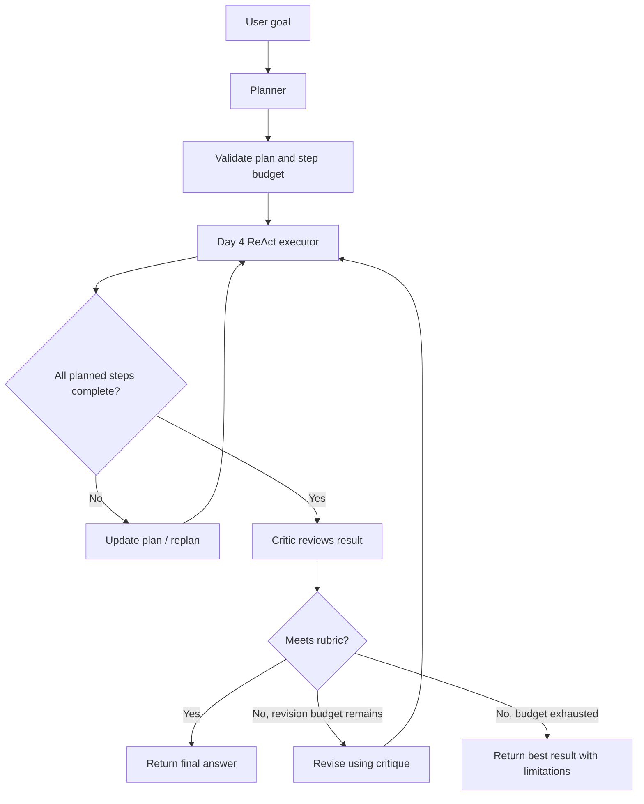
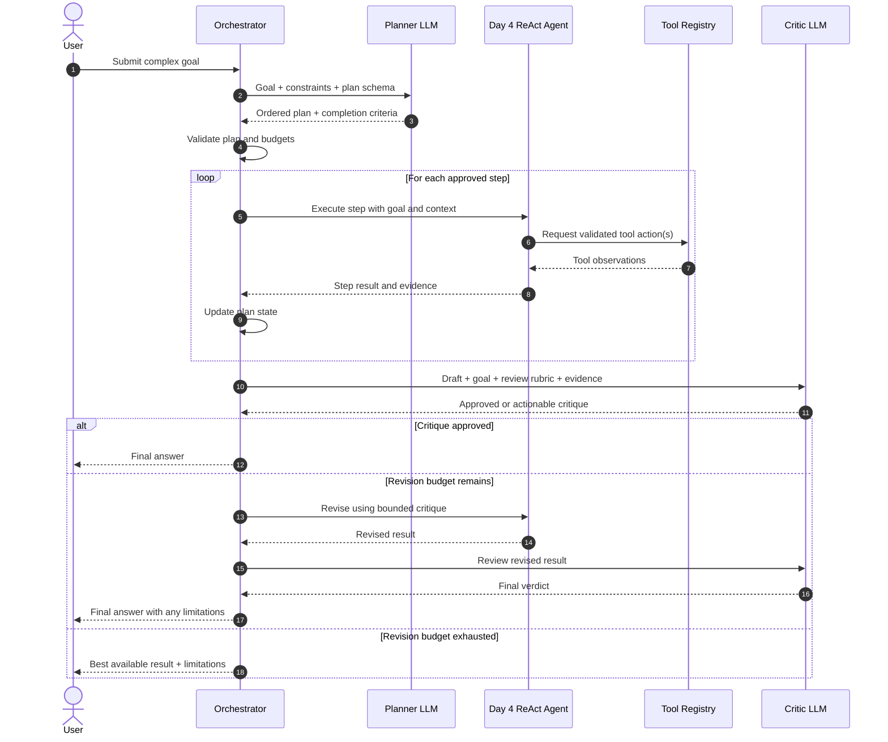

# Day 5 — Agent Patterns: Design, Implement, and Compare

**Roadmap:** Week 1 — LLM foundations and the agent loop  
**Prerequisite:** [Project 1 — From-Scratch Agent](./project-1-from-scratch-agent.md)  
**Goal:** Understand when to use common agent patterns, add planner and critic steps to the Day 4 ReAct agent, and compare approaches on the same 10 tasks.

---

## 1. The six patterns

### 1.1 Plan-and-execute

**Idea:** Split the task into two phases. A planner creates a sequence of steps; an executor performs them, optionally replanning when reality differs from the plan.

**Example:** "Research three vector databases, compare their pricing and features, and write a recommendation."
1. Planner creates research, comparison, and recommendation steps.
2. Executor performs each step using available tools.
3. The orchestrator checks progress and replans if a step fails or new information changes the plan.
4. The agent returns the recommendation.

**Use when:** The task has multiple dependent stages and a useful high-level plan can be created up front.

**Avoid when:** The task is simple, short, or the next action is obvious. Planning adds model calls and can create a brittle plan when the environment changes.

### 1.2 Reflection / self-critique

**Idea:** Ask the model to review a draft or completed result against explicit criteria, then revise it when the critique identifies actionable problems.

**Example:** Generate an API design, critique it for security, reliability, and missing edge cases, then revise it.

**Use when:** Quality matters, there are clear review criteria, and an additional model call is worth the potential improvement.

**Avoid when:** The task is trivial, latency/cost is strict, or the critic has no reliable criteria. A model agreeing with itself does not prove correctness.

**Important:** Reflection is not verification. Use deterministic tests, schema validation, retrieved evidence, or human review for claims and actions that need stronger guarantees.

### 1.3 Router

**Idea:** Classify the request and send it to the best specialized handler or workflow.

**Example:** An interview-preparation assistant routes:
- "Explain attention" → concept explainer.
- "Quiz me on RAG" → quiz generator.
- "Review this architecture" → system-design reviewer.

**Use when:** Requests fall into a small number of known categories and each category has a different prompt, model, toolset, or workflow.

**Avoid when:** There are only one or two simple paths, or classification errors are costly and no fallback exists.

**Design tip:** Use structured route labels, validate them against an allowlist, define a fallback route, and measure routing accuracy.

### 1.4 Prompt chaining

**Idea:** Break a task into a fixed sequence of smaller LLM calls. Each step's output becomes the next step's input.

**Example:** Extract requirements → create an outline → draft an answer → format the result.

**Use when:** The stages are known in advance and each stage benefits from a focused prompt or a different output schema.

**Avoid when:** A single model call is sufficient, or the next step must be selected dynamically based on tool observations.

**Design tip:** Validate intermediate outputs. A bad early result can propagate through every later step.

### 1.5 Parallelization

**Idea:** Run independent tasks at the same time, then combine their results.

**Example:** Ask three independent researchers to evaluate different vector databases, then aggregate their findings.

**Use when:** Tasks are independent, can safely run concurrently, and the wall-clock reduction is valuable.

**Avoid when:** Tasks depend on one another, share a rate limit, mutate the same resource, or require expensive coordination.

**Design tip:** Bound concurrency, apply per-task timeouts, handle partial failures, and preserve source/provenance for each result. Parallel work may reduce elapsed time while increasing total token cost.

### 1.6 Orchestrator-worker

**Idea:** A central orchestrator decomposes work, assigns bounded subtasks to workers, tracks their results, and synthesizes the final answer.

**Example:** A market research task is split into competitor research, customer analysis, and pricing research. Workers return evidence-backed findings; the orchestrator resolves gaps and writes the report.

**Use when:** A task can be decomposed into distinct workstreams that benefit from specialization or parallel execution.

**Avoid when:** The task is small, workers duplicate work, coordination dominates, or the task requires tightly shared state.

**Design tip:** Give each worker a narrow task, explicit output schema, tool permissions, deadline, and token budget. The orchestrator remains responsible for final validation and synthesis.

---

## 2. Pattern comparison

| Pattern | Control flow | Best fit | Main trade-off |
|---|---|---|---|
| Plan-and-execute | Plan, then execute/replan | Multi-step tasks | Planning overhead; plan can become stale |
| Reflection / self-critique | Draft, critique, revise | Quality improvement | Extra calls; critique may be wrong |
| Router | Classify, dispatch | Known task categories | Misrouting and fallback design |
| Prompt chaining | Fixed sequential stages | Predictable transformations | Error propagation between stages |
| Parallelization | Concurrent independent calls | Independent research/work | Higher aggregate cost and rate-limit pressure |
| Orchestrator-worker | Decompose, delegate, synthesize | Complex multi-workstream tasks | Coordination and duplicated work |

### Quick pattern selection guide

- **Known sequence of steps?** Start with prompt chaining or a deterministic workflow.
- **Need to decide which specialized path handles the request?** Use a router.
- **Many dependent steps with a useful outline?** Consider plan-and-execute.
- **Need a quality pass against explicit criteria?** Add reflection, then verify with tests/evidence.
- **Independent subtasks?** Consider parallelization.
- **Several distinct workstreams need coordination?** Consider orchestrator-worker.

These patterns can be combined, but begin with the simplest design that meets the requirements.

---

## 3. Day 5 implementation — add planner and critic to the Day 4 agent

Keep the Day 4 ReAct loop as the executor. Add two optional components around it:

- **Planner:** Turns the user's goal into a short, ordered list of steps with completion criteria.
- **Critic:** Reviews the final draft against a task-specific rubric and either approves it or returns actionable revision feedback.

### Proposed architecture



The planner and critic are model calls. The application orchestrator owns validation, execution, retry limits, and stopping conditions. Do not let a model-generated plan bypass the Day 4 tool permission checks.

### Sequence diagram



### Suggested state shape

Use a typed state object (for example, a Python dataclass or Pydantic model):

| Field | Purpose |
|---|---|
| `goal` | Original user request |
| `plan` | Validated list of steps |
| `current_step` | Index/status of the active step |
| `observations` | Tool results and evidence collected |
| `draft` | Current candidate answer |
| `critique` | Latest critic feedback |
| `revision_count` | Number of revisions already attempted |
| `max_revisions` | Hard limit, e.g. 1 |
| `token_usage` / `estimated_cost` | Usage and cost accounting |
| `started_at` / `deadline` | Execution time boundary |
| `status` | Running, completed, failed, or budget-exhausted |

### Planner output contract

Ask the planner for structured data, not free-form prose. Example:

```json
{
  "goal": "Compare three vector databases and recommend one",
  "steps": [
    {
      "id": "step-1",
      "description": "Identify the three products and official documentation",
      "completion_criteria": "Each product has a verified official source"
    },
    {
      "id": "step-2",
      "description": "Compare relevant features and operational trade-offs",
      "completion_criteria": "A comparison table has evidence for each row"
    },
    {
      "id": "step-3",
      "description": "Write a recommendation for the stated requirements",
      "completion_criteria": "Recommendation explains assumptions and trade-offs"
    }
  ]
}
```

Validate the schema, maximum number of steps, non-empty descriptions, and allowed task scope. A plan is a proposal, not permission to execute arbitrary actions.

### Critic rubric

Give the critic explicit criteria relevant to the task. For a research answer, a rubric might be:

1. Does the answer address the original goal?
2. Are important claims supported by observations or sources?
3. Are there contradictions or missing steps?
4. Are assumptions and uncertainty stated?
5. Is the answer clear and appropriately concise?

Use a structured response:

```json
{
  "approved": false,
  "issues": [
    {
      "criterion": "Evidence",
      "problem": "The pricing comparison has no supporting source",
      "suggested_fix": "Retrieve official pricing information or mark it unknown"
    }
  ],
  "overall_feedback": "The answer is useful but needs evidence for pricing."
}
```

The critic must not invent evidence. The orchestrator should cap revisions (start with one), and should not loop indefinitely between writer and critic.

### Implementation pseudocode

```python
async def run_planned_agent(goal: str, limits: Limits) -> Result:
    state = initialize_state(goal, limits)

    plan = await planner.create_plan(goal)
    state.plan = validate_plan(plan, limits.max_steps)

    for step in state.plan.steps:
        enforce_budget(state)

        step_result = await react_agent.execute(
            goal=step.description,
            context=state.observations,
            completion_criteria=step.completion_criteria,
            limits=remaining_limits(state),
        )
        state.observations.append(step_result)
        state.current_step += 1

        if step_result.is_blocked:
            state.plan = await planner.replan(
                goal=goal,
                completed=state.observations,
                remaining=state.plan.steps[state.current_step:],
            )

    state.draft = synthesize(goal, state.observations)

    for _ in range(limits.max_revisions):
        enforce_budget(state)
        critique = await critic.review(
            goal=goal,
            draft=state.draft,
            evidence=state.observations,
            rubric=limits.review_rubric,
        )
        if critique.approved:
            return Result(answer=state.draft, state=state)

        state.draft = await revise(
            goal=goal,
            draft=state.draft,
            critique=critique,
            evidence=state.observations,
        )

    return Result(
        answer=state.draft,
        status="completed_with_limitations",
        state=state,
    )
```

This is architectural pseudocode: adapt it to the actual Day 4 agent interfaces and provider SDK. In production, catch and classify model/tool errors, persist state where needed, and enforce the same budgets inside every nested call.

---

## 4. Compare on 10 tasks

Run the same 10 representative tasks against:
- **Baseline:** Day 4 ReAct agent without planner or critic.
- **Variant A:** ReAct + planner.
- **Variant B:** ReAct + critic.
- **Variant C:** ReAct + planner + critic.

Keep the model, tool implementations, system constraints, task inputs, and evaluation rubric constant. If model output is stochastic, run each task multiple times or report the run count and variability.

### Suggested task set

| # | Task | What it tests |
|---:|---|---|
| 1 | Calculate a result with the calculator tool | Simple tool selection |
| 2 | Find a fact from a supplied document | Retrieval and evidence use |
| 3 | Search for current information and summarize it | Multi-step research |
| 4 | Compare two options using supplied criteria | Decomposition and synthesis |
| 5 | Read a file, transform its contents, and save output | Sequential tool use |
| 6 | Diagnose an error from a provided log | Reasoning over evidence |
| 7 | Create a short answer with a strict JSON schema | Structured output |
| 8 | Complete a task where the first tool call fails once | Recovery and replanning |
| 9 | Handle ambiguous input by asking a clarifying question | Uncertainty handling |
| 10 | Complete a multi-part task with independent subtasks | Planning and possible parallel work |

Use deterministic fixtures or recorded tool responses where possible. Do not use live external services for one variant and mocks for another.

### Metrics to record

| Metric | Definition |
|---|---|
| Task success rate | Tasks meeting the predefined success criteria / total tasks |
| Quality score | Rubric score for correctness, completeness, and evidence |
| End-to-end latency | Wall-clock time from request to final response |
| Model calls | Total LLM requests, including planner and critic |
| Token usage | Input and output tokens, reported separately |
| Estimated model cost | Token usage × the selected model's applicable rates |
| Tool calls | Number of tool invocations |
| Failure rate | Tasks ending in an error or failing acceptance criteria |

Do not treat a critic's own approval as the quality score. Evaluate outputs independently using deterministic checks, evidence checks, or a blinded human rubric. Record the model name/version, prompt version, date, and pricing assumptions with the results.

### Results template — fill with measured values

| Variant | Success / 10 | Quality score | Avg latency (s) | Avg input tokens | Avg output tokens | Avg cost |
|---|---:|---:|---:|---:|---:|---:|
| ReAct baseline | — | — | — | — | — | — |
| ReAct + planner | — | — | — | — | — | — |
| ReAct + critic | — | — | — | — | — | — |
| ReAct + planner + critic | — | — | — | — | — | — |

**Do not fill the table with invented results.** Populate it after running the experiment. Report failures and incomplete runs rather than silently excluding them.

### How to interpret the results

- If planner improves success on complex tasks but increases latency, decide whether the reliability gain justifies the overhead.
- If critic improves independently scored quality, check whether the gain is large enough to justify the extra call and tokens.
- If planner + critic performs worse than either alone, inspect error propagation, prompt conflicts, and whether the task set actually needs both.
- If all variants perform similarly, keep the simpler ReAct baseline.
- If parallelization is tested later, compare wall-clock latency and total cost separately; parallel work can be faster without being cheaper.

---

## 5. Interview drill

### Q1. When would you choose plan-and-execute over a basic ReAct agent?

**Answer:** I would choose plan-and-execute when a task has several meaningful stages and an outline helps coordinate dependencies or track completion. For a short task where the next action is obvious, a basic ReAct loop is simpler and cheaper. I would also allow replanning because tool observations can invalidate the original plan.

### Q2. Does adding a critic guarantee a better answer?

**Answer:** No. A critic is another model call and can miss errors or introduce incorrect feedback. I would define a task-specific rubric, limit revisions, and evaluate the final result independently using tests, evidence, or human review.

### Q3. What is the difference between prompt chaining and plan-and-execute?

**Answer:** Prompt chaining follows a developer-defined sequence of stages. Plan-and-execute uses a generated plan to organize the task and may adapt that plan based on execution results. Chaining is usually more predictable; planning is more flexible but adds uncertainty and overhead.

### Q4. When would you use a router?

**Answer:** When incoming requests belong to known categories with different handlers, prompts, or tools. I would use structured route outputs, an allowlist, a fallback, and routing accuracy tests.

### Q5. Parallelization vs. orchestrator-worker?

**Answer:** Parallelization is the execution strategy for independent work. Orchestrator-worker is a coordination pattern in which a central component decomposes work, delegates tasks, tracks results, and synthesizes the outcome. An orchestrator-worker design may use parallel execution for its workers.

### Q6. How do you justify the extra cost of planning and reflection?

**Answer:** I compare variants on the same task set and measure success, independently scored quality, end-to-end latency, token usage, and estimated cost. I keep the extra steps only if the measured improvement is worth their operational cost for the target use case.

### Q7. How do you prevent planner/critic loops from running forever?

**Answer:** The application owns hard limits: maximum plan steps, maximum replans, maximum critique revisions, wall-clock deadline, token/cost budget, and per-call timeouts. When a limit is reached, it returns the best available result with limitations.

---

## 6. Completion checklist

- [ ] Can explain all six patterns without memorizing definitions.
- [ ] Can choose a pattern and justify why simpler alternatives are insufficient.
- [ ] Added a planner to the Day 4 ReAct agent.
- [ ] Added a critic with an explicit rubric and bounded revision count.
- [ ] Validated planner and critic outputs with schemas.
- [ ] Ran baseline, planner, critic, and combined variants on the same 10 tasks.
- [ ] Recorded success, quality, latency, tokens, and estimated cost.
- [ ] Filled the results table with actual measurements.
- [ ] Documented at least one failure and what it taught you.

## Day 5 takeaway

Agent patterns are architectural choices, not features to add by default. Start with the smallest reliable design, add planning when task decomposition helps, add critique when measurable quality improvement is worth the cost, and use evaluation data to defend the trade-off.
