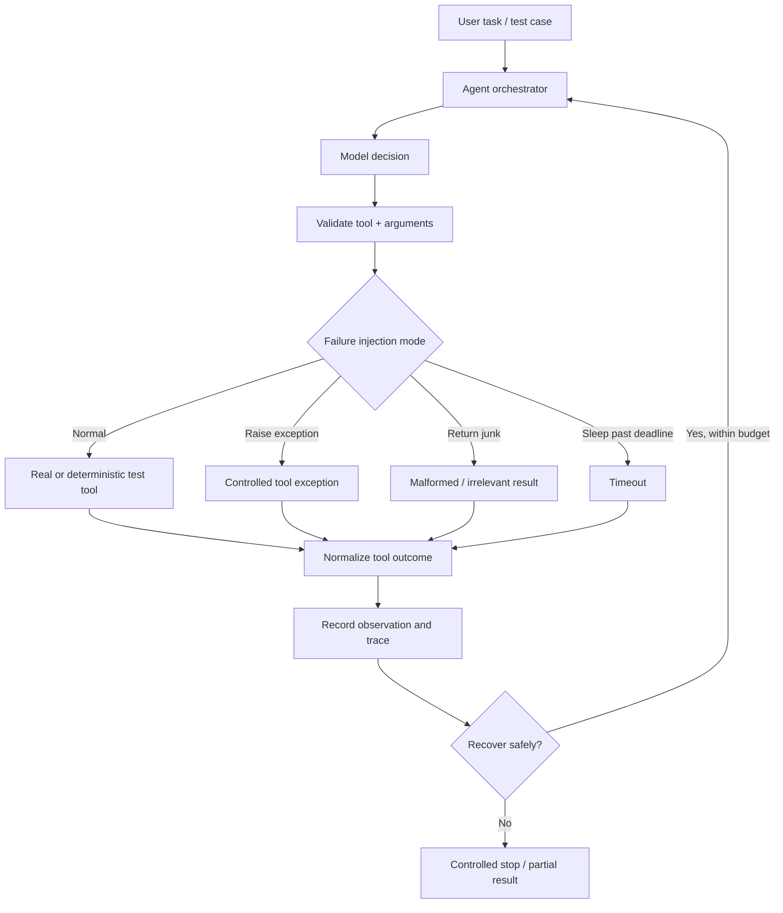

# Day 6 — Agent Failure Modes, Recovery, and Consolidation

**Roadmap:** Week 1 — LLM foundations and the agent loop  
**Prerequisite:** [Project 1 — From-Scratch Agent](./project-1-from-scratch-agent.md) and [Day 5 — Agent Patterns](./day-5-agent-patterns.md)  
**Goal:** Make the framework-free agent fail safely, recover from transient problems, and produce traceable evidence of what happened.

---

## 1. Why agents fail differently from ordinary functions

A traditional function usually has a defined input/output contract. An agent combines probabilistic model decisions, external tools, mutable state, and repeated execution. A small error can therefore affect later decisions.

Example:
1. The model generates an incorrect search query.
2. Search returns irrelevant content.
3. The model treats that content as evidence.
4. A later tool call writes an incorrect summary.
5. The final answer confidently reports the wrong result.

This is **error compounding**: early mistakes propagate through later steps. Production agents need validation and recovery at every boundary, not only a final-answer check.

## 2. Four core failure modes

### 2.1 Infinite or repetitive loops

**Symptoms**
- The agent repeatedly calls the same tool with identical arguments.
- It alternates between two tools without making progress.
- It keeps replanning the same failed step.
- It never emits a final response.

**Causes**
- No explicit completion criteria.
- Tool results do not give the model enough information to choose a different action.
- The model ignores or misinterprets an error.
- The orchestrator has no hard execution limits.

**Safeguards**
- Maximum agent steps and model calls.
- Wall-clock deadline and per-tool timeout.
- Token and cost budgets.
- Detect repeated identical tool+argument signatures.
- Detect short cycles in action sequences where appropriate.
- Give the model a concise error observation, but do not allow it to override application limits.
- Return a controlled partial result when a limit is reached.

Do not block every repeated tool name: reading two different files is legitimate. Detect repeated actions using canonicalized tool arguments and, where useful, recent action sequences.

### 2.2 Hallucinated or invalid tool arguments

**Symptoms**
- Unknown tool name.
- Missing or extra parameters.
- Wrong types or invalid enum values.
- Plausible but incorrect IDs, paths, dates, or amounts.
- Arguments that are syntactically valid but do not match the user's intent.

**Safeguards**
- Allowlist tool names in the registry.
- Validate every tool's arguments against its own strict schema.
- Enforce business rules and authorization separately from schema validation.
- Resolve resource IDs against trusted application data.
- Ask the user to clarify ambiguous or high-impact inputs.
- Never treat a model-generated argument as permission to perform an action.

Schema validation catches structural errors, not every semantic error. For example, a valid numeric amount can still be the wrong amount.

### 2.3 Context bloat

**Symptoms**
- Prompts become increasingly large.
- Latency and token costs rise across steps.
- Relevant observations are buried in old history.
- The model starts overlooking important constraints.

**Causes**
- Sending the entire conversation and every tool result on every turn.
- Repeating large documents or search results.
- Keeping verbose errors and duplicate observations.
- Never summarizing completed work.

**Safeguards**
- Keep the original goal and critical constraints available.
- Store full tool results outside the prompt; pass only relevant excerpts and references.
- Summarize completed steps while preserving key facts, source references, and unresolved items.
- Deduplicate repeated observations.
- Limit tool output size and retrieved content.
- Track input and output tokens per model call and cumulatively.
- Never summarize away permissions, safety constraints, or facts needed to verify the final answer.

### 2.4 Error compounding

**Symptoms**
- A failed tool call is treated as successful.
- An unsupported claim becomes an input to a later action.
- The agent writes or sends incorrect information based on stale observations.
- The final answer hides an earlier failure.

**Safeguards**
- Use structured tool outcomes with explicit success/error status.
- Keep provenance: which tool produced each observation and when.
- Validate and normalize tool results before adding them to state.
- Distinguish "no result" from "tool failed".
- Require evidence for important claims.
- Use deterministic checks or human approval for consequential operations.
- Stop or replan when required evidence is missing.

---

## 3. Failure-injection architecture

Build test-only tools that deliberately fail in controlled ways. Keep them separate from production tools and expose them only in a test environment.



The orchestrator—not the model—decides whether retrying is safe and whether budget remains.

## 4. Implement failure-injection tools

Example test-only Python tools:

```python
import asyncio

def fail_with_exception(message: str = "injected failure"):
    raise RuntimeError(message)

def return_junk():
    # Structurally valid Python value, but not the expected domain result.
    return {"unexpected": ["junk", None, 123]}

async def sleep_past_deadline(seconds: float = 10):
    await asyncio.sleep(seconds)
    return {"status": "finished"}
```

Use a test harness to register these tools under explicit names such as `test_raise_error`, `test_return_junk`, and `test_slow_tool`. Do not expose these tools to normal users.

### Normalize outcomes

Prefer one predictable envelope for tool results:

```python
from dataclasses import dataclass
from typing import Any

@dataclass
class ToolOutcome:
    ok: bool
    data: Any = None
    error_code: str | None = None
    message: str | None = None
    retryable: bool = False
```

Example:
- Success: `ToolOutcome(ok=True, data={"items": [...]})`
- Timeout: `ToolOutcome(ok=False, error_code="TIMEOUT", message="Tool deadline exceeded", retryable=True)`
- Invalid arguments: `ToolOutcome(ok=False, error_code="INVALID_ARGUMENTS", message="The query field is required", retryable=False)`

Do not send stack traces, credentials, or internal infrastructure details to the model. Log diagnostic details securely and return a safe, concise error observation.

## 5. Recovery policy

| Failure | Default response | Retry policy |
|---|---|---|
| Invalid tool name | Reject and record error | No blind retry; model may choose an allowed tool |
| Invalid arguments | Return validation feedback | Correct arguments, bounded retry |
| Transient network error | Structured tool error | Retry with backoff if operation is safe |
| Timeout | Mark outcome unknown or timed out | Check status before retrying side effects |
| Tool returns junk | Validate result and reject | Retry only if a new attempt can plausibly help |
| Permission denied | Stop that action | Never retry to bypass authorization |
| Missing source/evidence | Mark information unavailable | Search/retrieve differently within budget |
| Repeated identical action | Stop or request a different approach | Do not repeat automatically |
| Token/time budget exhausted | Controlled stop | No further model/tool calls |

### Retry rules

- Use bounded retries with exponential backoff and jitter for transient failures.
- Respect provider `Retry-After` instructions and rate limits.
- Do not retry deterministic failures such as invalid arguments or permission denial without changing the cause.
- Use idempotency keys or deduplication for side-effecting operations.
- A timeout does not prove an operation failed; check its execution status before retrying.
- Keep retries inside the overall task deadline and budget.

## 6. Add recovery behavior to the Day 4 agent

Keep the existing ReAct loop and registry. Add these boundaries:

1. Validate the model decision before tool dispatch.
2. Validate the tool result before storing it as an observation.
3. Convert exceptions and timeouts into typed error observations.
4. Record each action signature, attempt number, duration, and outcome.
5. Retry only errors classified as retryable and only within a small configured limit.
6. Stop on permission errors, exhausted budgets, repeated actions, or unrecoverable failures.
7. Return a partial result with explicit limitations when safe completion is impossible.

Pseudocode:

```python
async def execute_safely(tool, arguments, state):
    validated_args = tool.args_schema.model_validate(arguments)

    if not state.has_budget():
        return ToolOutcome(
            ok=False,
            error_code="BUDGET_EXHAUSTED",
            message="Execution budget exhausted",
        )

    for attempt in range(tool.max_retries + 1):
        try:
            result = await asyncio.wait_for(
                tool.execute(**validated_args.model_dump()),
                timeout=tool.timeout_seconds,
            )
            validated_result = tool.result_schema.model_validate(result)
            return ToolOutcome(ok=True, data=validated_result.model_dump())

        except asyncio.TimeoutError:
            outcome = ToolOutcome(
                ok=False,
                error_code="TIMEOUT",
                message="Tool deadline exceeded",
                retryable=tool.is_idempotent,
            )
        except ValidationError:
            outcome = ToolOutcome(
                ok=False,
                error_code="INVALID_RESULT",
                message="Tool returned data outside its result schema",
            )
        except PermissionError:
            return ToolOutcome(
                ok=False,
                error_code="PERMISSION_DENIED",
                message="The operation is not permitted",
            )
        except Exception:
            outcome = ToolOutcome(
                ok=False,
                error_code="TOOL_ERROR",
                message="Tool execution failed",
                retryable=tool.is_idempotent,
            )

        if not outcome.retryable or attempt == tool.max_retries:
            return outcome

        await asyncio.sleep(backoff_with_jitter(attempt))

    return outcome
```

This is a design sketch: define `ValidationError`, `asyncio`, `backoff_with_jitter`, and the tool metadata in your implementation. For non-idempotent operations, do not infer retry safety merely from a timeout; query operation status or use a durable idempotency mechanism.

---

## 7. Failure-injection test plan

Use deterministic tests with a mocked model and test-only tools. Unit tests should not require a live LLM API call.

| Test | Injected condition | Expected behavior |
|---|---|---|
| 1 | Tool raises an exception once | Error is recorded; safe recovery may succeed |
| 2 | Tool always raises | Bounded attempts, then controlled failure |
| 3 | Tool returns wrong result shape | Result validation rejects it |
| 4 | Tool sleeps beyond deadline | Timeout outcome; agent respects deadline |
| 5 | Model requests unknown tool | Registry rejects it; function is not executed |
| 6 | Model sends missing/extra arguments | Schema validation rejects dispatch |
| 7 | Model repeats identical call | Loop detector stops after configured threshold |
| 8 | Model alternates two actions | Cycle/step limit stops the loop |
| 9 | Tool returns a very large result | Output is capped or summarized safely |
| 10 | Token budget is exhausted | No additional model or tool call occurs |
| 11 | Tool returns prompt-injection text | Content is treated as untrusted observation |
| 12 | Side-effecting call times out after submission | Status is checked; duplicate action is prevented |

### Example pytest tests

```python
import pytest
from pydantic import BaseModel, ConfigDict, ValidationError

class SearchArgs(BaseModel):
    model_config = ConfigDict(extra="forbid")
    query: str

def test_rejects_extra_arguments():
    with pytest.raises(ValidationError):
        SearchArgs(query="React", admin=True)

def test_rejects_missing_argument():
    with pytest.raises(ValidationError):
        SearchArgs()

def test_repeated_action_signature_is_stable():
    first = action_signature("calculator", {"a": 2, "b": 3})
    second = action_signature("calculator", {"b": 3, "a": 2})
    assert first == second

@pytest.mark.asyncio
async def test_timeout_is_converted_to_controlled_outcome():
    async def slow_tool():
        await asyncio.sleep(1)

    with pytest.raises(asyncio.TimeoutError):
        await asyncio.wait_for(slow_tool(), timeout=0.01)
```

Add integration tests around your actual orchestrator to assert that the tool was not executed after invalid validation, that retries are bounded, and that the final state/status is correct. The timeout unit test above checks the timeout primitive; it is not a substitute for testing your safe-execution wrapper.

Run:

```bash
pytest -v
```

---

## 8. Observability: what to capture in a failure trace

Each agent run should have a correlation ID and structured events.

| Field | Why it matters |
|---|---|
| Run ID / step number | Reconstruct one execution |
| Model and prompt version | Compare behavior across changes |
| Tool name and sanitized arguments | Understand requested action |
| Validation outcome | Identify bad model decisions |
| Start/end time and duration | Diagnose latency |
| Retry count and error code | Understand recovery |
| Token usage and estimated cost | Track budgets |
| Observation reference | Trace the source of later decisions |
| Final status | Measure completion and failure rates |

Redact API keys, passwords, personal data, and sensitive tool output. Avoid logging full prompts or documents by default.

## 9. Interview drill

### Q1. What are the most common production failure modes in agents?

**Answer:** Repeated or infinite loops, invalid or hallucinated tool arguments, context bloat, tool timeouts/exceptions, and error compounding. I would instrument each model/tool boundary and add validation, bounded retries, execution budgets, and safe stopping behavior.

### Q2. How do you prevent a bad tool result from corrupting the rest of the task?

**Answer:** Validate tool results against a result schema before adding them to agent state. Store provenance and explicit success/error status. Treat external content as untrusted, and require evidence or deterministic checks before using important claims in later actions.

### Q3. How do you handle a tool timeout when the tool may already have completed?

**Answer:** A timeout only means the caller did not receive a response before its deadline. It does not prove the operation failed. For side-effecting tools, I would use an idempotency key or execution ID and query the operation's status before deciding whether to retry.

### Q4. How do you control context bloat?

**Answer:** Keep the original goal and critical constraints, store large tool outputs outside the prompt, retrieve only relevant excerpts, summarize completed steps with provenance, deduplicate observations, and track token usage. I would never summarize away safety instructions or facts needed to verify the answer.

### Q5. How do you distinguish a transient error from a permanent error?

**Answer:** Classify errors by type and provider status. Network failures, temporary rate limits, and some server errors may be retryable with backoff. Invalid arguments, permission errors, and missing required resources generally need correction rather than blind retries.

### Q6. What is error compounding?

**Answer:** An early incorrect observation or decision influences later steps, causing multiple downstream errors. I reduce it with validation at every boundary, source tracking, explicit error states, evidence checks, and stopping or replanning when required information is unreliable.

### Q7. How would you test an agent without paying for model calls on every test?

**Answer:** Unit-test the orchestrator with a deterministic fake model that returns predefined decisions. Inject fake tools that succeed, fail, time out, or return invalid results. Keep a smaller integration/evaluation suite against the real model to measure end-to-end behavior.

### Q8. What should happen when the agent cannot safely complete a task?

**Answer:** Stop execution, preserve the trace and completed work, and return a clear partial result explaining what succeeded, what failed, and what remains unknown. It should not invent completion or continue beyond its limits.

---

## 10. Day 6 deliverables

- [ ] Document infinite loops, invalid tool arguments, context bloat, and error compounding.
- [ ] Add test-only tools that raise exceptions, return junk, and time out.
- [ ] Normalize tool success and failure into structured outcomes.
- [ ] Add result validation and bounded retry policy.
- [ ] Test unknown tools and invalid arguments.
- [ ] Test repeated actions and maximum-step stopping.
- [ ] Test timeout and side-effect retry safety.
- [ ] Test large tool output and token-budget exhaustion.
- [ ] Capture sanitized execution traces.
- [ ] Write a `What broke and why` failure log.
- [ ] Update the project README with recovery behavior and test commands.

## 11. What to put in the failure log

For every injected failure, record:

| Field | Example |
|---|---|
| Scenario | Search tool times out |
| Expected behavior | Timeout is surfaced; bounded retry only if safe |
| Actual behavior | Fill after running the test |
| Root cause | Fill after investigation |
| Fix | Fill after implementing |
| Regression test | Test name and result |

Do not claim a failure is fixed until the regression test passes.

## Day 6 takeaway

A production agent is not defined only by how it succeeds. It is defined by how safely and transparently it behaves when the model, context, tools, or network fail. Make every boundary observable, every retry bounded, and every stopping condition enforceable by application code.
