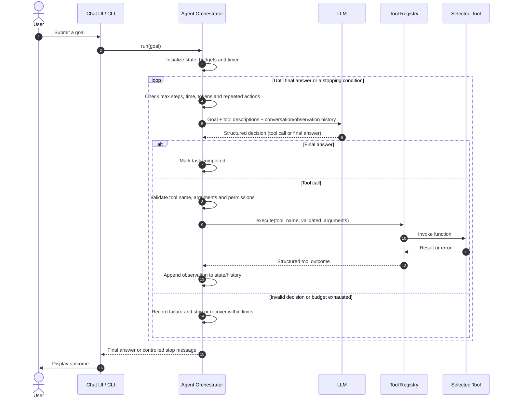

# Project 1 — From-Scratch Agent

**Source roadmap:** Week 1, Days 1–6.  
**Day 4 focus:** ReAct agent loop and sequence diagram.

## Objective

Build and explain a working tool-calling ReAct agent in plain Python before adopting an agent framework.

## Required capabilities

- CLI chat interface, streaming, conversation history, token/cost tracking.
- Structured tool schemas and argument validation.
- Calculator, web search, file read/write, and sandboxed Python execution.
- Observe–reason–act–observe loop with max steps, token budget, timeout, and loop detection.
- Planner and critic experiment across 10 tasks.
- Failure injection for exceptions, junk output, and timeouts.

## ReAct agent sequence diagram

The diagram shows one complete agent task. The orchestrator is ordinary application code: it owns the loop, validates model decisions, applies limits, invokes tools, stores observations, and decides whether another model call is allowed.

## Sequence diagram walkthrough

### 1. User submits a goal

The user sends a task in natural language, for example:

> Find the latest React release, calculate how many months have passed since its release, and save a short summary to a file.

The CLI forwards the goal to the agent orchestrator. The orchestrator creates an agent state containing the original goal, step counter, history, token usage, start time, and execution status.

### 2. Orchestrator prepares the model request

The orchestrator sends the LLM:
- The original user goal.
- Available tool names and descriptions.
- Relevant conversation history.
- Previous tool calls and observations.
- The current step and applicable constraints.

The LLM does not execute tools. It returns a structured decision: either request a tool with arguments or provide a final answer.

### 3. Orchestrator checks the decision

Before acting, application code checks:
- Is the requested tool registered?
- Are all required arguments present and valid?
- Is the user authorized to use this tool?
- Are step, time, token, and cost budgets still available?
- Has this exact action already been repeated too many times?

A model-generated tool call is untrusted input. The application must enforce these checks independently of the model.

### 4. Tool registry executes the action

The registry maps the approved tool name to its implementation. It invokes the selected function with validated arguments.

Examples:
- `web_search(query)` retrieves current information.
- `calculator(a, b, operation)` performs a calculation.
- `write_file(filename, content)` saves a note.

The tool should return a structured success result or a structured error. Side-effecting tools also need authorization, idempotency or deduplication where appropriate, and audit logging.

### 5. Tool result becomes an observation

The orchestrator appends the tool outcome to agent state/history. This is the observation in the ReAct loop.

The next model request includes the observation, allowing the LLM to decide whether another action is needed or whether it has enough information to finish.

Tool output is untrusted data. It must not be treated as higher-priority instructions.

### 6. Loop repeats or stops

The loop continues until the model returns a valid final answer or a stopping condition is reached.

Typical stopping conditions:
- Final answer generated.
- Maximum number of steps reached.
- Execution deadline exceeded.
- Token or cost budget exhausted.
- Repeated-action loop detected.
- Unrecoverable model or application error.

When a limit is reached, the orchestrator returns a controlled status rather than continuing indefinitely.

### 7. Final response reaches the user

The orchestrator returns the final answer or a clear message explaining why execution stopped. The CLI displays it to the user.

## Participants and responsibilities

| Participant | Responsibility |
|---|---|
| User | Defines the goal and may approve sensitive actions |
| CLI / Chat UI | Collects input and displays progress/results |
| Agent orchestrator | Owns state, loop, limits, validation and control flow |
| LLM | Chooses the next action or produces a final response |
| Tool registry | Resolves approved tool names to implementations |
| Tool | Performs one bounded external or local operation |

## How to explain this in an interview

> "I use an orchestrator to manage the agent lifecycle. It initializes state and sends the user goal, tool descriptions and prior observations to the LLM. The LLM returns a structured decision: either a tool request or a final response. The orchestrator validates the tool name and arguments, checks authorization and execution budgets, and invokes the tool through a registry. It stores the tool result as an observation and sends the updated context to the model. This observe–decide–act–observe cycle continues until the model returns a final answer or a stopping condition is reached. The LLM proposes actions, but the application owns execution and security."

## Workflow vs. agent

- **Workflow:** The developer defines a mostly fixed sequence of steps. Use it when the task is predictable and the same steps should run every time.
- **Agent:** The LLM selects the next action based on the goal and previous observations. Use it when the next step genuinely depends on information discovered during execution.

Prefer a deterministic workflow when it can solve the task. Agents add model latency, cost, and non-determinism.

## Production safeguards to call out

- Validate every tool argument with a tool-specific schema.
- Enforce authentication, authorization, least privilege, and human approval for sensitive actions.
- Set maximum steps, wall-clock deadline, token/cost budget, and per-tool timeout.
- Detect repeated identical actions without blocking legitimate repeated tool use with different arguments.
- Treat retrieved pages, files, and tool outputs as untrusted data.
- Use idempotency keys or deduplication for side-effecting operations.
- Persist execution state and trace IDs for long-running or resumable tasks.
- Log tool name, duration, outcome, retry count, and errors while redacting secrets and sensitive data.

## Evidence to publish

- Architecture/sequence diagram (this document).
- Framework-free agent implementation and tests.
- Sample successful and failed execution traces.
- README with setup, tool contracts, and safety boundaries.
- `What broke and why` failure log.
